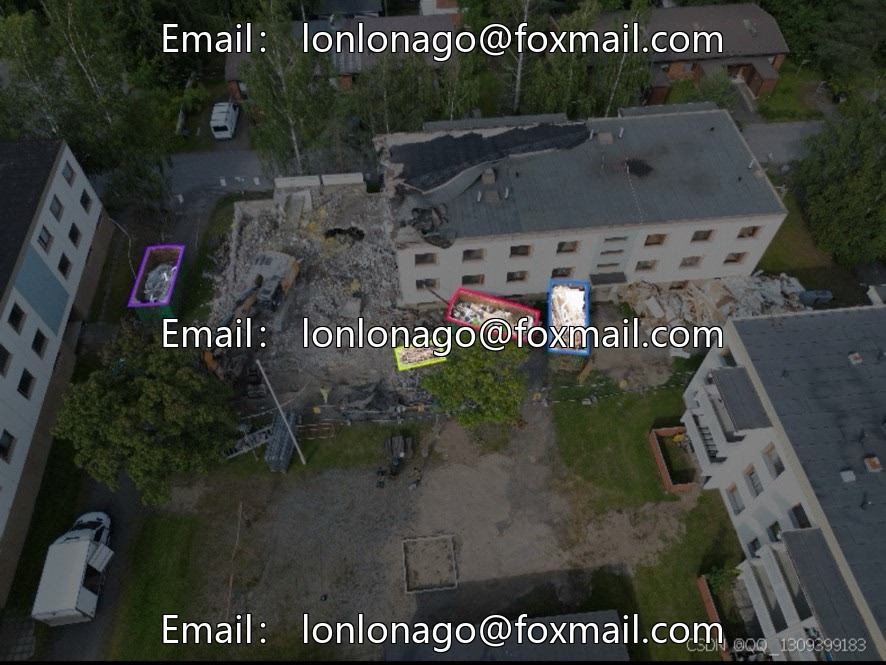
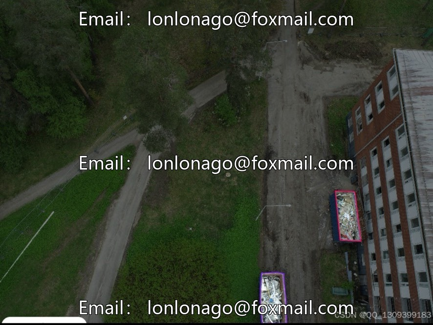
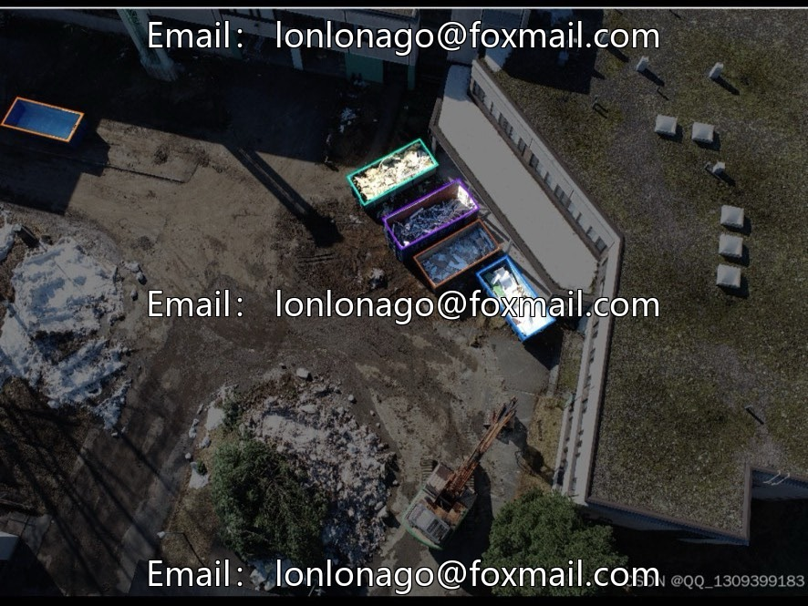
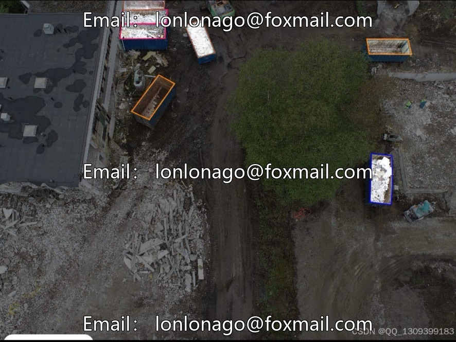
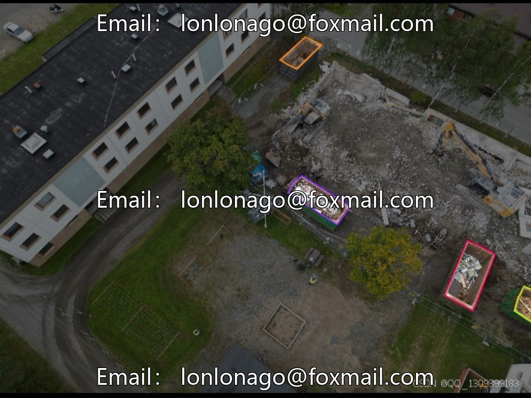

# Architectural waste aerial photography dataset, 2204 high-definition aerial images, with a maximum resolution of 547

## Body

Architectural Waste Aerial Photographs Dataset, 2204 high-definition aerial images with the highest resolution of 5472×3648. The dataset includes mainstream models such as DJI Mini 3 Pro, Mavic 2 Pro, Phantom 4 Pro V2, etc. Data is collected from multiple devices, covering various scenarios of waste disposal in construction demolition.

Data is segmented into 12 major categories, supporting training validation testing splits of 7:2:1 or 8:1:1. The structure is clear and suitable for scenarios such as computer vision, drone inspection, waste sorting, sanitation supervision, environmental protection project evaluation, etc. It can be used for model training, algorithm verification, and practical deployment.

Categorization: Cover, Electronic Waste, Empty, Gravel, Insulator-Wool, Metal, Mixed Waste, Plasterboard, Polystyrene, Roofing Felt, Wood, Wood Panel, etc.

Virtual materials, once sold, are non-refundable.
Interested friends, click "I want" to proceed.

## Images

## Payment

Here is a pay link on Stripe ( https://buy.stripe.com/3cs8yP7sY87d0vu9AB ). Please contact me lonlonago@foxmail.com after funding $89, and I will send you a complete data files , thank you!

